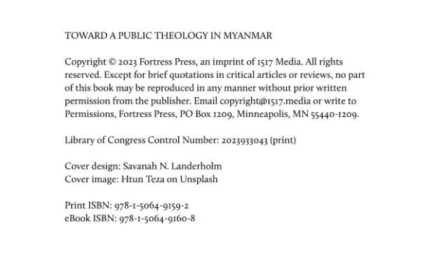
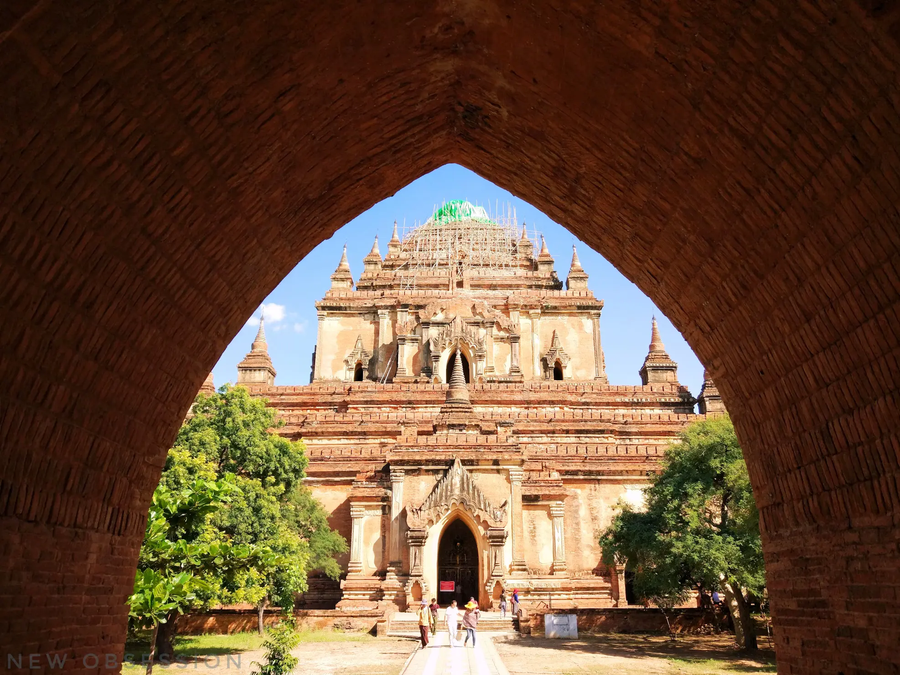

So, I just found out that the [photo I share on Unsplash](https://unsplash.com/photos/brown-concrete-building-under-blue-sky-at-daytime-u8-hP05Ou4E) was used as the cover image for [this book](https://isbnsearch.org/isbn/9781506491592). Considering it was published as paperback print in October 2023, I guess I am now a published photographer.

	
	
    

 
  

